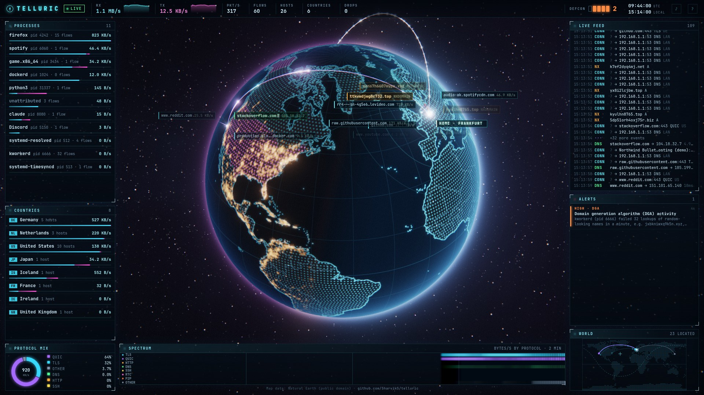
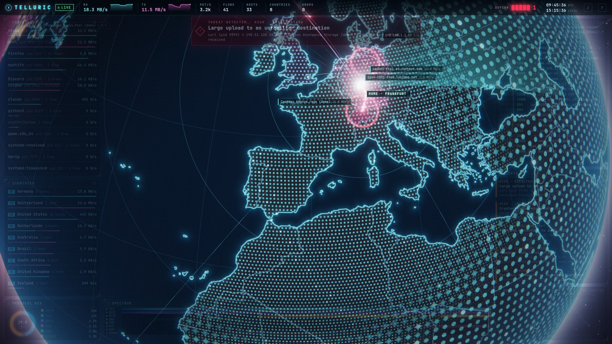
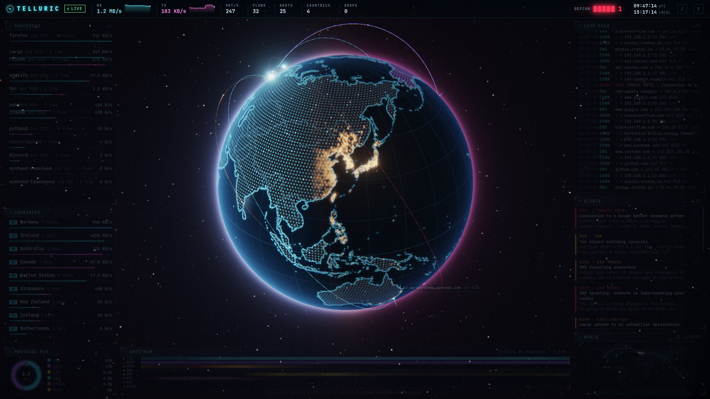

<div align="center">

# T E L L U R I C

**Your machine's live network traffic, rendered on a 3D globe.**

[**Live demo**](https://sharviks.github.io/telluric/) ·
[Architecture](docs/ARCHITECTURE.md) ·
[Detection](docs/DETECTION.md) ·
[Wire protocol](docs/PROTOCOL.md) ·
[Renderer](docs/FRONTEND.md)

[](https://github.com/SharvikS/telluric/actions/workflows/ci.yml)




</div>

Every connection your computer makes becomes an arc to where the other end
really is. Every packet is a comet racing along it. DNS lookups pop up over
the cities they resolve to, labelled with the program that asked. A stack of
detectors watches the traffic for beaconing malware, generated domains, DNS
tunnels, scans, exfiltration, leaked passwords and ARP spoofing. When
something is wrong, the globe turns red.

*Telluric currents are the electric currents that flow through the Earth.
These are yours.*

| The alert theatre: an exfiltration in progress | DEFCON 1, with real night-side city lights |
|---|---|
|  |  |

*Every frame above is the real engine running `--demo`: synthetic packets
go through the same decoders and detectors as live traffic.*

```console
$ make build && ./bin/telluric --demo
  ╔╦╗╔═╗╦  ╦  ╦ ╦╦═╗╦╔═╗
   ║ ║╣ ║  ║  ║ ║╠╦╝║║
   ╩ ╚═╝╩═╝╩═╝╚═╝╩╚═╩╚═╝
  mode    demo (demo)
  globe   http://127.0.0.1:7777/?token=4f9c…
```

## Everything is built from first principles

The only dependency outside the Go standard library is `golang.org/x/sys`.
The front end uses no 3D or UI library.

| Layer | What's inside |
|---|---|
| **Capture** | A `TPACKET_V3` memory-mapped ring: the kernel hands over 1 MiB blocks of frames, with no system call or copy per packet. Truncation happens in the kernel via a one-instruction classic BPF program. |
| **Privilege separation** | Only a small helper ever holds `CAP_NET_RAW`. It opens the ring, then drops every capability **on every thread** and sets `no_new_privs`. The parsers that read attacker-controlled bytes never run privileged. This is Wireshark's `dumpcap` design. |
| **Decoders** | IPv4/IPv6 (extension-header chains, fragments), TCP, UDP, ICMP (including the datagram quoted inside errors), ARP and DNS. All of them avoid allocation. |
| **Names in encrypted traffic** | Passive DNS with CNAME chains and HTTPS-record hints. TLS ClientHellos reassembled across out-of-order segments, because post-quantum key shares no longer fit in one. **QUIC Initial decryption** (RFC 9001/9369 key schedule, header protection, AES-GCM, shuffled CRYPTO frames) reveals the SNI of HTTP/3. JA4 fingerprints and ECH and ML-KEM detection come from the same parse. |
| **Engine** | A single-owner event loop with no locks on the hot path. It tracks flows, the TCP state machine and handshake RTT, and attributes traffic to processes through `/proc` and cgroups (systemd unit, Flatpak app, container). |
| **Geolocation** | An in-house **MaxMind DB reader** over a read-only `mmap`, using the DB-IP Lite databases. Home is found with a STUN binding request, falling back to the time zone's coordinates. |
| **Detection** | Threat-intelligence feeds plus behavioural detectors, including streaming **Half-Space Trees**. See [below](#detection). |
| **Transport** | An in-house **RFC 6455 WebSocket** server. JSON frames carry state; a 12-byte binary record carries each animated packet. A two-lane queue ensures a slow tab loses animation frames, never state. |
| **Renderer** | Raw **WebGL2**. Arcs and comets are animated entirely on the GPU from instanced attributes. The HDR bloom pipeline and the procedural dot-matrix Earth come from Natural Earth data via a bespoke texture generator. |

## Numbers

Measured on an i7-14700F with `go test -bench`:

| | |
|---|---|
| Packet decode (IPv4/TCP) | **8 ns**, 0 allocations |
| Whole engine hot path, 2,000 live flows | **~70 ns/packet**, 0 allocations (~15 Mpps per core) |
| DNS response with a CNAME chain | 115 ns, 0 allocations |
| QUIC Initial: derive keys, unprotect, decrypt | 245 ns per packet |
| Geolocation lookup in the 127 MB DB-IP City database | **65 ns**, 0 allocations |
| Static binary with the embedded UI | ~10 MB |

## Verified, not just tested

- **RFC test vectors**: QUIC v1 and v2 Initial key derivation and the header-protection mask (RFC 9001 A.1/A.2, RFC 9369 A.1), and the WebSocket handshake (RFC 6455 §1.3).
- **Differential testing against Wireshark.** Real `crypto/tls` ClientHellos, over TCP and inside QUIC Initials, are written to a capture. Telluric's SNI and JA4 must match Wireshark's own dissectors byte for byte, with Wireshark doing its own QUIC decryption. tshark must also parse the capture helper's pcapng stream.
- **Fuzzing** of every parser: packets, DNS, TLS, QUIC, pcap/pcapng and MaxMind DB.
- **The race detector** runs across the whole suite in CI.
- **End-to-end tests**: crafted traffic goes in and the wire protocol comes out. Names, SNI, JA4, a 40 ms RTT and byte-exact packet totals are asserted.
- **Security tests** check token authentication, cross-site WebSocket hijacking and DNS-rebinding defenses.

## Quick start

```sh
git clone https://github.com/SharvikS/telluric && cd telluric
make build                      # bin/telluric + bin/telluric-capture, Go 1.26+

./bin/telluric --demo           # a synthetic world, no privileges needed

make setcap                     # once: grant the capture helper CAP_NET_RAW
./bin/telluric                  # your real traffic

./bin/telluric --replay x.pcapng --speed 4   # replay any capture
```

Open the printed URL. It contains a session token, because the stream reveals
everything your machine talks to. Press `?` in the UI for keyboard shortcuts.

On first run Telluric downloads the DB-IP Lite geolocation databases (about
130 MB) and the threat feeds into `~/.local/share/telluric`. They refresh
monthly and every six hours, respectively. `--no-update` turns this off.

<details>
<summary>All flags</summary>

```
--demo               run a synthetic world instead of capturing
--replay file        replay a pcap/pcapng file in real time (--speed N)
-i iface             capture interface (default any)
--capture method     auto | ring | helper | dumpcap
--listen addr        UI address (default 127.0.0.1:7777)
--home lat,lon       pin the home location (default: STUN + geolocation, else time zone)
--no-stun            don't ask a STUN server for the public address
--data-dir dir       databases and feeds (default ~/.local/share/telluric)
--no-update          never download databases or feeds
--no-procs           don't attribute traffic to processes
--no-detect          disable detection and feed downloads
--open               open the UI in the default browser
--ui-dir dir         serve the UI from disk (front-end development)
--update-geo         download the geolocation databases and exit
```

</details>

### How capture privileges work

Telluric picks the first source that works:

1. **In-process ring.** Used when Telluric itself may open raw sockets (root, or `setcap` on the binary).
2. **The capture helper** (`telluric-capture`). `make setcap` grants *it* `cap_net_raw,cap_net_admin`. It holds them for a few microseconds, then runs with no capabilities at all, streaming pcapng to the engine. Its output is standard, so it can also feed Wireshark: `./bin/telluric-capture | wireshark -k -i -`.
3. **Wireshark's `dumpcap`**, when you're in the `wireshark` group.

## Detection

| | Signal |
|---|---|
| **Threat intel** | abuse.ch ThreatFox (live C2s by malware family), Feodo Tracker, SSLBL, URLhaus; Spamhaus DROP; Tor exits. Addresses, SNI, HTTP `Host`, and every name in a DNS answer chain are checked. |
| **Beaconing** | Periodic connections, measured robustly: median interval, MAD jitter, Bowley skew. |
| **DGA** | Bursts of NXDOMAIN answers for names that score high on a lexical-randomness model. |
| **DNS tunneling** | Many unique long subdomains under one domain, mostly TXT. |
| **Scans** | Port sweeps against this machine (LAN vs. internet), and worm-like outbound sweeps. |
| **Exfiltration** | Large, lopsided uploads to destinations with no known service. |
| **Cleartext credentials** | HTTP Basic, FTP, POP3, IMAP, and SMTP AUTH sent without TLS. |
| **ARP spoofing** | An established IP→MAC binding changes hands. Router impersonation is critical. |
| **Cryptominers** | The Stratum mining protocol in a TCP payload. |
| **Anomalies** | Streaming Half-Space Trees over seven per-flow features. |

Alerts name the responsible process whenever there is one (an ARP spoof or
an inbound scan comes from another device). The global threat level, the
**DEFCON** meter, is a decayed, severity-weighted alert pressure. Details,
thresholds and false-positive notes are in [docs/DETECTION.md](docs/DETECTION.md).
The demo plays every scenario every four minutes.

## Security and privacy

- Telluric never sends your traffic anywhere. The UI listens on loopback
  only, behind a random session token. An `HttpOnly`, `SameSite=Strict`
  cookie carries it.
- WebSocket handshakes must come from Telluric's own origin, which blocks
  cross-site hijacking. On loopback, the `Host` must be a loopback name,
  which blocks DNS rebinding. A strict CSP blocks the rest.
- Its only outbound requests are geolocation and threat-feed downloads, and
  one STUN packet to learn your public address (`--no-stun`).
- `.gitignore` refuses `*.pcap` files, so real captures never get committed.

## Development

```sh
make test     # unit + end-to-end + Wireshark differential tests
make race     # the same under the race detector
make fuzz     # every fuzz target, FUZZTIME=20s each
make bench    # the numbers above
./bin/telluric --demo --ui-dir web/ui   # live-edit the front end
go run ./tools/geogen -out web/ui/assets   # rebuild globe textures from Natural Earth
```

Repository layout and design decisions: [docs/ARCHITECTURE.md](docs/ARCHITECTURE.md).

## Credits

- IP geolocation by [DB-IP](https://db-ip.com) (CC BY 4.0)
- Map data from [Natural Earth](https://www.naturalearthdata.com) (public domain)
- Threat intelligence from [abuse.ch](https://abuse.ch), [Spamhaus](https://www.spamhaus.org) and the [Tor Project](https://www.torproject.org)
- JA4 fingerprinting specification by [FoxIO](https://github.com/FoxIO-LLC/ja4) (BSD-3-Clause)
- Half-Space Trees: Tan, Ting & Liu, *Fast Anomaly Detection for Streaming Data*, IJCAI 2011

## License

MIT
